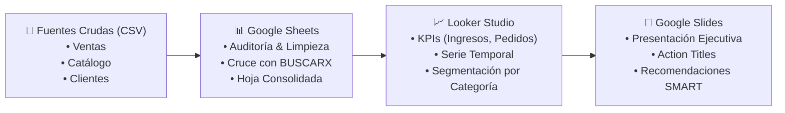

# 📊 E-Commerce Commercial Performance & BI Consulting Analysis

> **Autor:** Nicolás Snider  
> **Rol:** Junior BI Consultant & Data Analyst  
> **Programa:** Talento Tech — Buenos Aires Ciudad  
> **Comisión:** C26230  
> **Marco Metodológico:** Simulación corporativa con DataWise Consulting  

---

## 🎯 Resumen Ejecutivo del Proyecto

Proyecto integral de **Business Intelligence y Business Analytics** orientado a resolver la opacidad analítica de un e-commerce regional en expansión. 

A través del procesamiento y saneamiento de transacciones comerciales, se modelaron bases de datos relacionales, se diseñó un **Dashboard Interactivo en Google Looker Studio** y se formularon recomendaciones estratégicas orientadas a mitigar riesgos de concentración y maximizar el margen de contribución.

🔗 **[Acceder al Dashboard Interactivo en Vivo en Looker Studio](https://datastudio.google.com/reporting/f018ad32-ad7a-4298-bd32-47886943561f/page/5bIDG)**  
📁 **[Acceder a la Carpeta de Entregables en Google Drive](https://drive.google.com/drive/folders/14-8eHduYkfBSQloTnHgG2jChtONxZ7hz)**

---

## 🏗️ Arquitectura y Flujo de Datos

---

## 📌 Indicadores Clave de Desempeño (KPIs Maestros)

Durante el período analizado (marzo 2024), sobre un universo de **34 transacciones validadas**:

| Métrica | Valor Obtenido | Interpretación de Negocio |
| :--- | :---: | :--- |
| **Facturación Total** | **\$ 1.670.100 ARS** | Ingresos brutos consolidados en el período. |
| **Volumen de Pedidos** | **34 transacciones** | Cantidad de órdenes únicas despachadas con éxito. |
| **Ticket Promedio** | **\$ 14.150 ARS** | Gasto promedio representativo por compra realizada. |

---

## 🔍 Principales Hallazgos de Negocio (*Action Titles*)

### 1. Concentración Crítica: Electrónica representa más del 55% de los ingresos
* La facturación está fuertemente apalancada por productos de alto valor unitario (monitores gamer, auriculares bluetooth y periféricos), sumando casi **\$ 1.000.000 ARS**.
* En contraste, categorías de rotación masiva como **Accesorios** e **Indumentaria** representan menos del **15%** del volumen total, evidenciando una falta de diversificación comercial.

### 2. Estacionalidad Marcada: El 70% de la facturación ocurre en los primeros 11 días
* Se identificaron picos excepcionales de ventas el **2 de marzo** y el **11 de marzo** (superando los **\$ 250.000** y **\$ 390.000 ARS** diarios respectivamente), coincidentes con el cobro de salarios.
* Durante la segunda quincena se observó una desaceleración pronunciada con ingresos promedio diarios inferiores a **\$ 50.000 ARS**.

---

## 🚀 Recomendaciones Estratégicas (Plan de Acción SMART)

1. **Estrategia de Venta Cruzada (*Cross-Selling*):**
   * Configurar en la plataforma de e-commerce *bundles* automáticos (ej. comprar un monitor o teclado con 15% de descuento en accesorios complementarios) para elevar el ticket promedio a **\$ 18.000 ARS**.
2. **Promociones Relámpago de Mitad de Mes:**
   * Implementar campañas comerciales específicas entre los días 15 y 25 de cada mes para dinamizar la demanda y suavizar la caída de ingresos en la segunda quincena.
3. **Optimización de Compras e Inventario:**
   * Priorizar capital de trabajo en el catálogo de alta rotación (electrónica y sillas de oficina) para prevenir quiebres de stock en días pico, reduciendo el almacenamiento ocioso en accesorios.

---

## 🛠️ Stack Tecnológico Utilizado

* **Google Sheets:** Limpieza avanzada de datos, normalización de tipos, validación condicional y cruces relacionales (`BUSCARX`).
* **Google Looker Studio:** Modelado dimensional, cálculo de métricas agregadas, series temporales continuas y diseño de UI ejecutiva.
* **Google Slides & Storytelling:** Comunicación visual en 7 actos basada en *Action Titles* y orientación a la toma de decisiones.
* **Git & GitHub:** Control de versiones y gobernanza de entregables de analítica.

---

## 👤 Autor

* **Nicolás Snider** — *Consultor de BI & Analista de Datos*  
* **Programa:** Talento Tech — Buenos Aires Ciudad  
* **Comisión:** C26230  
